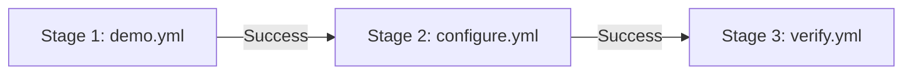

# Continue an AAP workflow after a host fails

Demonstrate a task failure on `demo2`, rescue it, and continue the same playbook
on `demo1` and `demo3`. Two subsequent job templates skip the failed host using
one shared `__workflow_host_failure_failed_hosts` artifact.

## Execution modes and validation

This is an **AAP 2.6+ workflow demo**, with CLI verification of the playbooks and
artifact handoff. Controller execution and the chosen execution environment still
need validation in your lab. CLI tests do not validate controller routing.

| Component | Requirement / validation |
| --- | --- |
| AAP | 2.6 or later; controller validation pending |
| ansible-core | CLI tested with 2.20.7 |
| ansible-lint | 26.6.0, production profile, strict |
| Collections | Only `ansible.builtin`; no Galaxy installation needed |
| Targets | Three local inventory aliases; no external machines needed |
| Execution environment | AAP 2.6-compatible EE with Python 3 and ansible-core; record your tested image tag/digest |

Run commands from the repository root. You need AAP permissions to create and
run a project, inventory, three job templates, and a workflow. The supplied local
inventory needs no machine credentials or privilege escalation. Private SCM and
EE registries may need their own credentials. No infrastructure is provisioned
and there are no additional infrastructure costs.

## How it works



1. `demo.yml` initializes `__workflow_host_failure_failed_hosts: []` once. Its action runs inside
   a `block`. When a task fails, `rescue` appends that host's inventory name to
   the global list with `set_stats`, then `meta: end_host` stops that host.
   Healthy hosts reach the final continuation message.
2. `configure.yml` republishes the inherited list before skipping previously
   failed hosts. Its own block/rescue can append additional failures. Republishing
   preserves earlier failures when this job exports the updated artifact.
3. `verify.yml` skips every host in the inherited list and verifies the rest.

Each playbook contains one play and targets the `workflow_demo` inventory group.
No temporary groups, completion facts, or shared task includes are required.
The actions check connectivity and print messages without persistent changes.
Replace the demonstration actions inside each block when adapting the example.

The list is global: `aggregate: true` appends each newly failed host, while
`aggregate: false` initializes or carries forward the list once per job. Publishing
stats does not change the inherited variable inside the current job; `end_host`
stops newly failed hosts immediately.

AAP passes global `set_stats` artifacts to downstream jobs as extra variables;
keep `per_host: false`. See the
[AAP 2.6 workflow documentation](https://docs.redhat.com/en/documentation/red_hat_ansible_automation_platform/2.6/develop-assembly_ug_controller_workflows).
A successfully rescued task failure allows the job to succeed, so this workflow
uses **Success** links. `clear_host_errors` is unnecessary. See
[Ansible block error handling](https://docs.ansible.com/projects/ansible-core/devel/playbook_guide/playbooks_blocks.html).

## Inputs

Custom variables use descriptive `snake_case` names and the shared
`workflow_host_failure_` prefix to identify this demo and reduce collisions.
The generated failed-host list uses the `__` prefix to mark internal workflow
state that users should not set. This convention does not enforce privacy.
Ansible-provided names such as `inventory_hostname` and
`ansible_connection` retain their standard names. See
[Good Practices for Ansible](https://redhat-cop.github.io/automation-good-practices/#_naming_things).

| Variable | Default | Purpose |
| --- | --- | --- |
| `workflow_host_failure_initial_fail_hosts` | `[demo2]` | Inventory hosts to fail in stage 1 |
| `workflow_host_failure_configure_fail_hosts` | `[]` | Optional additional failures in stage 2 |

Supply non-secret YAML lists of inventory names; `[]` disables intentional
failures for that stage. See [example variables](demo_vars.yml).
`__workflow_host_failure_failed_hosts` is the workflow output: do not define it in inventory,
workflow variables, surveys, or job template variables. For a standalone CLI
invocation of a downstream playbook, supply it explicitly to simulate inheritance.

## Run with AAP

Follow [AAP setup and presenter instructions](aap/README.md), then launch
**Host failure - continue survivors**. The committed
[demo inventory](inventory/demo.yml) supplies three local aliases.

In AAP, the aliases execute inside the same execution environment container.
They demonstrate separate Ansible host state, not separate operating systems.
For real machines, create an inventory with a `workflow_demo` group, remove the
local connection variables, configure SSH/Python, attach machine credentials to
every job template, and adjust the failure input names.

## Run and verify with the CLI

```bash
ansible-playbook -i demos/workflow-host-failure/inventory/demo.yml \
  demos/workflow-host-failure/playbooks/demo.yml
```

Expect exit code **0**, a simulated failure on `demo2`, and `STAGE 1 continued`
only for `demo1` and `demo3`. The recap shows `demo2` with `rescued=1` and
`failed=0`. Separate CLI invocations do not automatically share artifacts.
To demonstrate the next job manually:

```bash
ansible-playbook -i demos/workflow-host-failure/inventory/demo.yml \
  demos/workflow-host-failure/playbooks/configure.yml \
  -e '{"__workflow_host_failure_failed_hosts": ["demo2"]}'
```

The verification harness launches separate processes and passes actual global
stats from the test callback to the next process as extra variables:

```bash
python3 demos/workflow-host-failure/tests/verify_cli.py
ansible-lint --offline --config-file .ansible-lint demos/workflow-host-failure
```

It checks single and multiple failures, no failures, additional stage 2 failures,
all hosts failing, cumulative artifacts, rescued counts, and completion messages.
It also verifies that standalone downstream jobs default to no failed hosts.

When editing the test callback, select the Python environment prepared in the
[contribution instructions](../../CONTRIBUTING.md#validate-and-publish) in your
IDE. Pylance and Pylint need access to `ansible-core` to resolve its callback base
class. Install Pylint in that same environment and invoke it with
`python -m pylint demos/workflow-host-failure/tests/callback_plugins/capture_workflow.py`.
An isolated Pylint installation without Ansible can also report a misleading
"too few public methods" warning because it cannot inspect inherited methods.

## Expected results

| Scenario | Stage 1 failed list | Stage 2 failed list | Final action hosts |
| --- | --- | --- | --- |
| Defaults | demo2 | demo2 | demo1, demo3 |
| Both failure lists empty | Empty | Empty | demo1, demo2, demo3 |
| Stage 1 fails demo2; stage 2 fails demo3 | demo2 | demo2, demo3 | demo1 |
| Stage 1 fails all three | demo1, demo2, demo3 | demo1, demo2, demo3 | None |

List order is not significant. Jobs remain successful when all task failures are
rescued, even if every host is eventually skipped. Failed hosts can appear in
later job recaps because initialization or skip handling runs; configuration and
verification action messages must exclude them.

## Cleanup

No persistent target changes or fact cache entries are created. The CLI harness
removes its temporary files. In AAP, remove the demo workflow, three job templates,
and inventory/source when finished. Remove the project or EE registration only
if dedicated to this demo. Manage job history according to your lab policy.

## Limitations

- This demonstrates ordinary task failures. Unreachable hosts do not enter
  `rescue`; such a job fails and the Success link stops that branch.
- Actions outside a protected block, including the final verification tasks,
  can still fail the job normally. Add the same rescue pattern to additional
  stages when they need to record failures and continue.
- Missing `__workflow_host_failure_failed_hosts` defaults to `[]`, matching the simple skip
  pattern. A downstream job launched alone therefore acts on all demo hosts.
  Use the complete workflow for actual artifact inheritance.
- Use the same stable inventory for all jobs, one job slice, and the default
  linear strategy. Leave Limit and tags blank; do not add `serial` or skip
  initialization, rescue, or host exclusion tasks.
- This is a sequential workflow. Parallel branches updating the same artifact
  key require a separate merge design.
- Approval, project update, and inventory update nodes are controller actions
  without per-host targeting; this skip pattern applies to job template plays.
